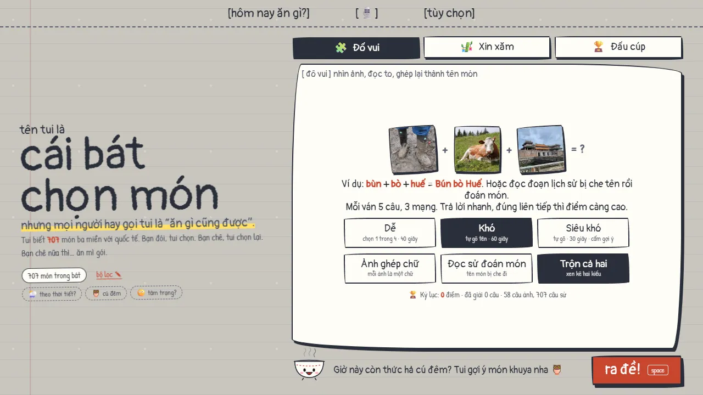

# Hôm nay ăn gì?

Không biết ăn gì thì bấm một nút, cái bát chọn dùm trong hơn 700 món ba miền Việt Nam và món của các cộng đồng ở Mỹ.

**[angi.nhaajt.com](https://angi.nhaajt.com)**



## Tính năng

- **3 cách chọn món:** đố vui (ảnh ghép chữ hoặc đọc lịch sử đoán tên), xin xăm, đấu cúp 8/16/32 món.
- **707 món**, mỗi món có ảnh thật, lịch sử ra đời, cách ăn kiểu bản xứ, công thức nấu nhanh và chỗ mua nguyên liệu ở Mỹ.
- **Chơi nhóm:** tạo phòng, cả nhóm cùng vote đấu cúp hoặc quẹt chọn món trên điện thoại; mỗi người được cấm một món; có màn hình TV kèm mã QR.
- **Gợi ý theo hoàn cảnh:** thời tiết (khi người dùng cho phép), ngày rằm và mùng 1, giờ khuya, tâm trạng, dịp lễ.
- **Hộ chiếu ẩm thực:** đóng dấu theo tỉnh và nước đã ăn, có huy hiệu.
- **Đố hôm nay:** cùng một đề cho mọi người mỗi ngày, có bảng xếp hạng tuần.
- 15 giao diện, cài được như ứng dụng (PWA), nhắc giờ ăn trưa, điều khiển bằng giọng nói.

## Cấu trúc

```text
index.html, style.css, skins.css   giao diện (một trang, không cần build)
js/                                logic phía trình duyệt (ES modules)
data/                              dữ liệu món ăn, câu đố, nguồn ảnh
img/, sfx/, icons/                 ảnh món, âm thanh, icon ứng dụng
vendor/                            thư viện dùng trực tiếp (GSAP, Rough.js, three.js, Matter.js, qrcode)
worker/index.js                    Cloudflare Worker: phòng chơi nhóm, bảng xếp hạng, thông báo
scripts/                           script gộp dữ liệu và tải ảnh từ Wikimedia Commons
```

Phần web là HTML, CSS và JavaScript thuần, không có bước build. Phòng chơi nhóm và bảng xếp hạng chạy trên Cloudflare Durable Objects. Thông báo nhắc ăn trưa dùng Web Push không kèm nội dung, nên chỉ cần khóa VAPID.

## Chạy ở máy

Cần Node.js 18 trở lên.

```bash
npm install
npx wrangler dev --ip 127.0.0.1
```

Chỉ xem phần giao diện (không có chơi nhóm, bảng xếp hạng):

```bash
npm run dev
```

## Deploy

Push lên nhánh `main` là Cloudflare Workers Builds tự chạy `npx wrangler deploy`. Deploy bằng tay:

```bash
npx wrangler deploy
```

Thông báo đẩy cần 2 secret của Worker: `VAPID_PUBLIC` (khóa công khai P-256 dạng base64url) và `VAPID_PRIVATE_JWK` (khóa riêng dạng JWK), đặt bằng `npx wrangler secret put`.

## Dịch vụ bên ngoài

- [Open-Meteo](https://open-meteo.com) để xem thời tiết, chỉ gọi khi người dùng bấm bật.
- [OpenStreetMap / Overpass](https://overpass-api.de) để tìm quán gần, chỉ gọi khi người dùng bấm tìm.
- Google Fonts cho phông chữ của từng giao diện.

## Giấy phép

Code dùng giấy phép [MIT](LICENSE). Ảnh món ăn, ảnh câu đố và âm thanh giữ giấy phép gốc của tác giả (CC BY, CC BY-SA, CC0…), xem chi tiết trong [CREDITS.md](CREDITS.md).
